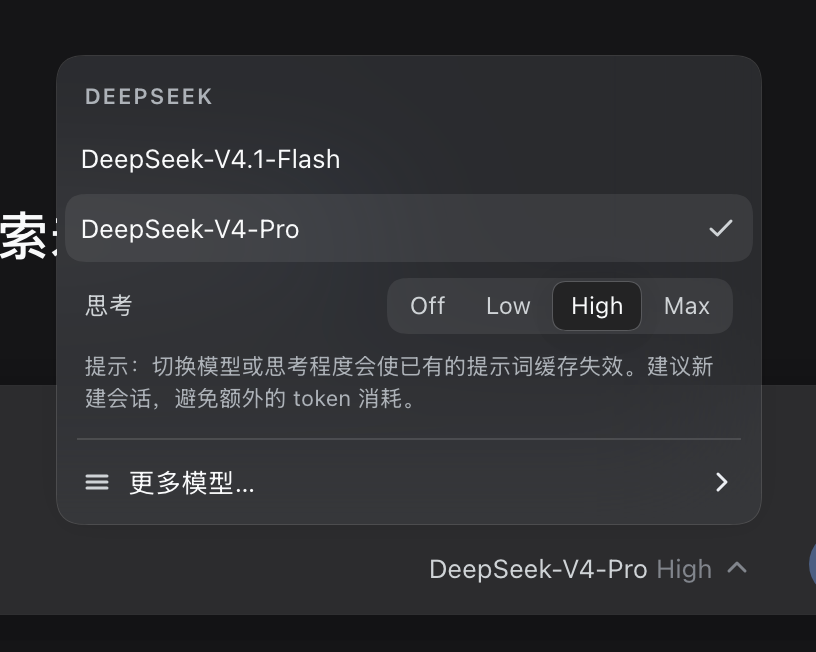
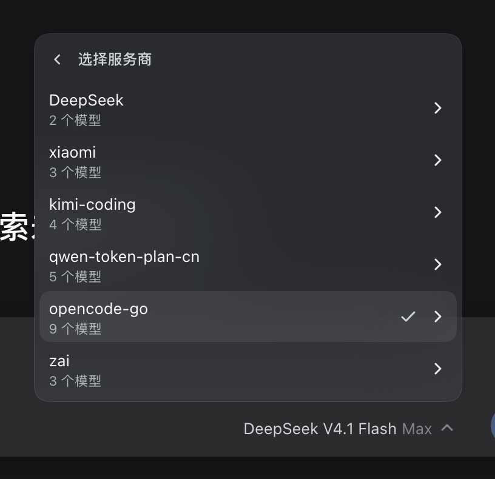
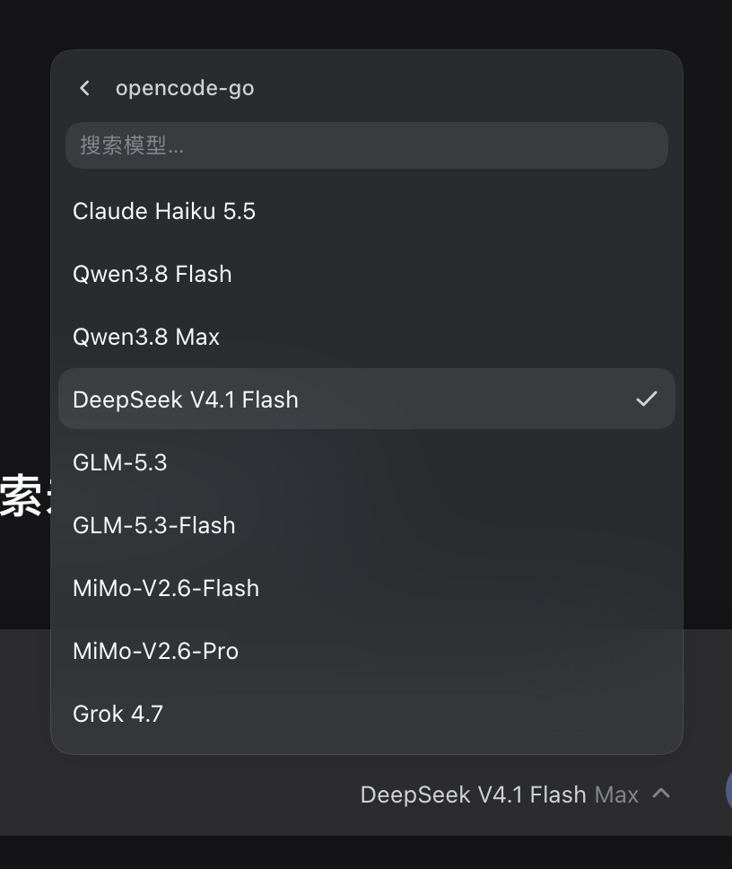

# dsh-model-selecter

**按服务商分组的 DSH 模型选择器。** 主面板只显示当前服务商的模型，想换服务商就点「更多模型…」，先选服务商，再选它的模型。

*DSH Web `0.2.1-rc.2` · MIT · 无构建步骤*



## 特性

- **两级菜单** —— 主面板只列当前服务商的模型，模型再多也不用翻遍所有服务商
- **吸附输入框** —— 菜单挂在输入框所在的滚动区域上，页面滚到底部回弹/上浮时跟随输入框一起移动
- **思考等级内置** —— `默认 / Off / Low / High / Max` 分段控件（以模型实际声明为准），点击立即生效
- **模型搜索** —— 服务商模型超过 6 个时自动出现搜索框并聚焦
- **缓存提示** —— 切换模型或思考程度会使提示词缓存失效，菜单里直接提醒
- **键盘可用** —— `↑` / `↓` 移动焦点，`Esc` 逐级返回，关闭后焦点回到触发器
- **主题一致** —— 颜色、圆角、阴影、菜单材质全部取自 `--dsw-*` 主题变量，跟随亮/暗主题
- **中英双语** —— 通过 DSH locale 服务注册文案，随界面语言切换
- **零侵入** —— 只覆盖 `conversation.input.model` 槽位，禁用插件即恢复内置选择器

## 截图

| 选择服务商 | 选择模型 |
| :---: | :---: |
|  |  |

## 安装

### 克隆到全局插件目录（推荐）

```bash
git clone https://github.com/Abyssaler/dsh-model-selecter.git ~/.dsh/plugins/dsh-model-selecter
dsh plugin --profile web add link:$HOME/.dsh/plugins/dsh-model-selecter
```

然后打开 DSH Web 的「插件」页，在「已安装插件」中找到 **dsh-model-selecter** 并打开开关。

### 已有本地副本

```bash
dsh plugin --profile web add link:/absolute/path/to/dsh-model-selecter
```

### 说明

DSH 的插件按 profile 启用：插件包只需安装一次，每个要用的 profile 执行一次 `dsh plugin add` 并在插件页打开开关即可。Client 半区只作用于 Web 界面，不影响 TUI / headless。

### 禁用 / 卸载

```bash
# 临时关闭：插件页关掉开关即可，内置选择器立刻回来
dsh plugin --profile web remove dsh-model-selecter
```

再从 `dsh.profile.bundles` 中移除 `dsh-model-selecter`。

## 使用

| 操作 | 结果 |
| --- | --- |
| 点击输入框右下角的模型名 | 展开主面板（当前模型自动聚焦） |
| 主面板点模型 / 思考等级 | 立即切换；点模型后菜单关闭并归还焦点 |
| 点「更多模型…」 | 进入服务商列表（含模型数量、当前项勾选） |
| 点某个服务商 | 进入它的模型列表（>6 个模型时出现搜索框） |
| 在模型列表选中模型 | 回到主面板，并切换到该服务商的模型 |
| `Esc` | 逐级返回；主面板再按一次关闭 |
| 点击菜单外部 | 关闭菜单 |

## 工作原理

- 注册 Client 槽位 `conversation.input.model`，以 `priority: -1` 覆盖内置的 `ModelSelect`（内置选择器注册在默认优先级 0）；插件被禁用或卸载后，内置选择器自动恢复，不需要改动宿主任何文件。
- 菜单通过 portal 挂到宿主的 **composer seat**（输入框所在的 sticky 区域）并绝对定位，因此与输入框共享同一套滚动/回弹位移；滚到页面底部出现上浮回弹时，菜单会跟着输入框一起移动。空会话（hero）布局下宿主没有 sticky seat，此时退回固定定位。
- 目录数据来自 `modelDirectories.directoryFor(sessionId)`：当前选择、可路由的服务商分组、模型与思考等级元数据，以及 `select()` 的写入结果（含 `session/writer-held` 等错误提示）。
- 文案通过 `ctx.locale.register('model-selecter', { zh, en })` 注册；模型名使用宿主目录中的名称，模型行内照常渲染第三方 label 子槽位内容。
- `/model` 弹窗不在本插件范围内，保持原生。

## 兼容性

| 项目 | 说明 |
| --- | --- |
| 目标版本 | DSH Web `0.2.1-rc.2` |
| 依赖的客户端服务 | `slots`、`modelDirectories`、`sessions`、`locale`、`remote`、`remote.session` |
| 构建 | 无（`client.js` 直接由 DSH 加载） |
| 宿主改动 | 无 |

## 目录结构

```
dsh-model-selecter/
├── package.json      # dsh.bundle / dsh.client 声明、exports、files
├── cordis.patch.yml  # bundle 层：插入一行 Loader 插件
├── index.js          # Host 半区（本插件没有 Host 行为）
├── client.js         # 客户端组件、样式、交互与内置 zh/en 字典
├── locale/           # 插件页卡片文案（zh / en）
├── icon.svg          # 插件图标
├── docs/             # README 截图
└── LICENSE
```

## 开发

```bash
git clone https://github.com/Abyssaler/dsh-model-selecter.git
cd dsh-model-selecter
dsh plugin --profile web add link:$PWD
```

修改 `client.js` 后刷新页面即可（link 安装时客户端会触发热更新）。项目没有测试套件；开发时用无头 Chromium 验证了菜单导航（主面板 → 服务商 → 模型）、搜索过滤、思考等级切换、`Esc` 与点击外部关闭、seat 吸附、禁用后内置选择器恢复。

## 已知限制

- 官方选择器会在 `conversation.input.model.label` 子槽位上注册声明，本插件复用该声明渲染模型名，因此其他插件挂在该子槽位上的**触发器徽标不会显示**（模型行内容不受影响）。
- 思考等级只在模型声明了 `reasoning.efforts` 时出现。
- 菜单最大宽度 352px，超长模型名会省略。

## English

`dsh-model-selecter` is a DSH client plugin that replaces the composer's flat model list with a provider-first selector. The root pane lists only the current provider's models plus the reasoning-effort segments and a **More models…** row; that row opens the provider list, and picking a provider drills into its models (with search when there are more than 6). The menu is portaled into the composer seat so it follows the composer during overscroll. It shadows the shipped seat at `conversation.input.model` with `priority: -1`, so disabling the plugin restores the built-in selector. No host files are modified and there is no build step.

## License

[MIT](LICENSE)
